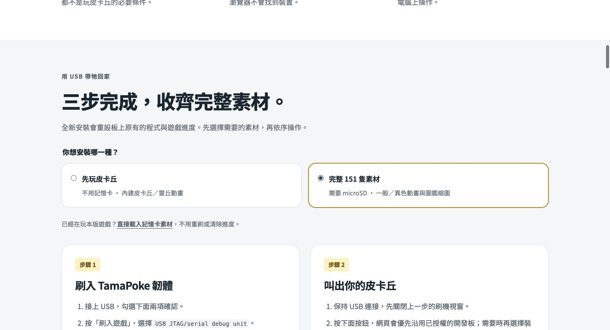
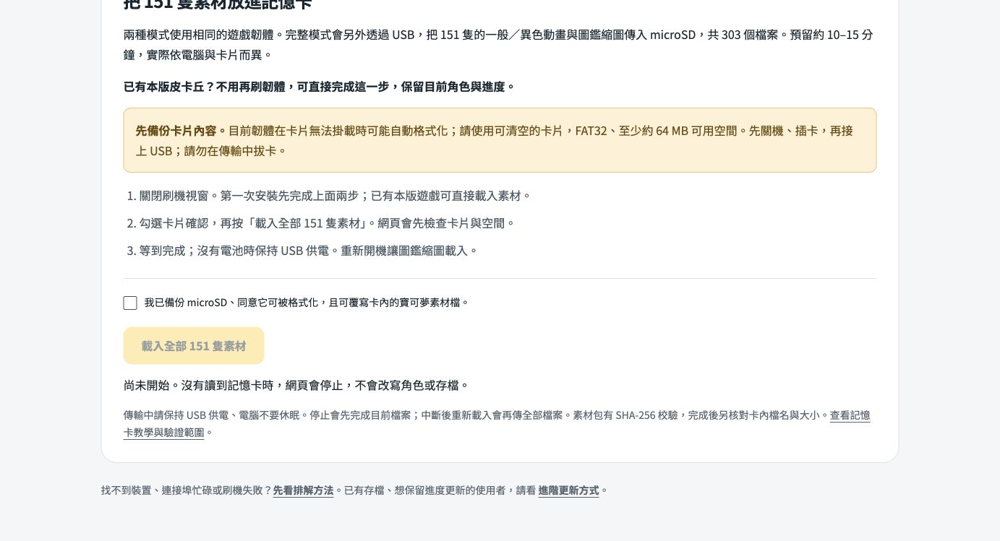
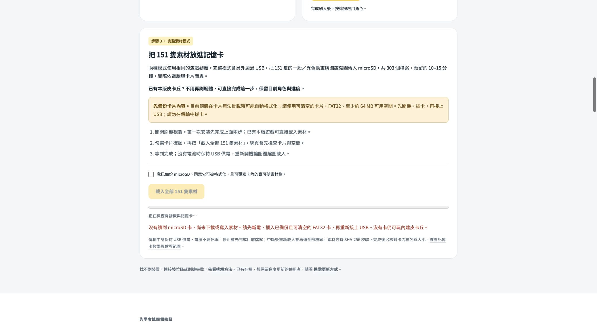

# 安裝完整 151 隻素材到 microSD

本教學適用 **微雪 Waveshare ESP32-S3-Touch-AMOLED-1.75 原版**與本 repo 的 `1.19-pika`。1.75C 是另一塊沒有 microSD 的板子，請勿套用。

兩種模式使用同一個已保存的遊戲韌體。選「完整 151 隻素材」會多做記憶卡載入：把 151 隻的一般／異色動畫與圖鑑縮圖放在 microSD，約 **42 MB、303 個檔案**。板上的 16 MB Flash 不用塞進全部素材。

| 網頁選項 | 需要記憶卡嗎 | 安裝內容 |
| --- | --- | --- |
| 先玩皮卡丘 | 不需要 | 遊戲與內建皮卡丘／雷丘動畫 |
| 完整 151 隻素材 | 需要 | 相同遊戲，加上 microSD 的完整動畫與縮圖 |

## 準備卡片

1. 使用**已備份、可以清空**的 microSD，格式 FAT32，至少約 64 MB 可用空間。
2. **目前韌體在卡片無法掛載時可能自動格式化。請在插卡前備份重要資料。** 素材載入也會取代 `/mons/` 裡同名的素材檔。
3. 先關機，再插入卡片。如果有接電池，長按 PWR 約四秒關機；只靠 USB 供電時可先拔除 USB。
4. 重新接上 USB 開機。程式在開機時讀卡，執行中插卡後應先重新開機。

## 第一次安裝

1. 在電腦版 Chrome 或 Edge 打開 [刷機網頁](https://maxxtang.github.io/TamaPoke-Pikachu/#install)。
2. 選「完整 151 隻素材」。
3. 依 [新手教學](GETTING_STARTED.md) 完成「刷入遊戲」和「連接並啟用皮卡丘」。全新刷機會清除舊程式與存檔。
4. 關閉刷機視窗，保持 USB 與 microSD 連接。
5. 在第三步勾選卡片確認，按「載入全部 151 隻素材」。有需要時選同一塊 USB 開發板。
6. 網頁先檢查遊戲、記憶卡與空間，再下載及 SHA-256 校驗完整素材包；之後才透過 USB 寫入。
7. 等進度與狀態顯示完成。預留約 10–15 分鐘，實際時間依電腦、USB 與卡片而異；不要讓電腦休眠或拔卡。
8. 完成後重新開機。保留卡片在板上，遊戲會讀取對應動畫與圖鑑縮圖。

## 已經有本版皮卡丘存檔

**不用再次全新刷機，也不用再啟用角色。** 準備卡片並重新開機後，選「完整 151 隻素材」，直接操作第三步即可。素材載入只寫入卡片的 `/mons/` 素材，不發送選角、時間或重設指令；遊戲存檔仍在板上 Flash。

下載全部素材**不會一次解鎖全部圖鑑，也不會把目前角色換掉**。遊戲仍一次養一隻，初始仍是皮卡丘；其他角色依後續蛋與進化取得。玩法見 [完整遊戲教學](PLAYING.md)。

## 中斷或失敗

| 狀況 | 處理方式 |
| --- | --- |
| 沒讀到 microSD | 網頁在下載與寫入前停止。關機確認插卡，再開機重試。 |
| 空間不足 | 網頁不開始傳輸。先在電腦備份／整理卡片，再放回板上開機。 |
| 想停止 | 按「停止傳輸」，會完成目前檔案再關閉連線，請等狀態更新。 |
| USB 拔掉、逾時、卡片寫入失敗 | 先重新開機，再按載入。會重新傳送全部素材，取代同名檔，不需要重刷遊戲。 |
| 剛完成但圖鑑仍沒有縮圖 | 等網頁釋放連線後重新開機，讓素材重新載入；圖鑑登錄紀錄仍依養成進度。 |

網頁對下載包做 SHA-256 校驗，每 2048 位元組等待開發板確認；完成後再核對卡上的 303 個檔名與大小。目前韌體沒有提供卡內檔案雜湊指令，因此最後核對不是卡內逐檔 SHA-256 比對。

## 驗證範圍與素材來源

完整包的 303 個檔案與每檔 SHA-256 已離線核對，Pikachu／Raichu 素材與本版內建資料相同。新增載入程式的自動測試使用模擬序列埠；另用原版開發板與公開網頁實測缺卡情況，確實在下載／寫入素材前停止。**完整 microSD 寫入仍待插卡實測**。已完成的網頁刷機、無卡皮卡丘啟用、重開機存檔和使用者畫面／觸控確認，見 [實機紀錄](HARDWARE_TEST.md)。

素材來自 [TamaPoke 官方素材包](https://socquique.github.io/TamaPoke/web/)，原圖為 PMD SpriteCollab 社群作品，保留 CC BY-NC 4.0 署名及非商業條件；Pokémon © Nintendo / Game Freak / The Pokémon Company。下載包與逐檔紀錄見 [full-sprite-pack.json](../evidence/full-sprite-pack.json)，授權見 [THIRD_PARTY_NOTICES.md](../THIRD_PARTY_NOTICES.md)。
