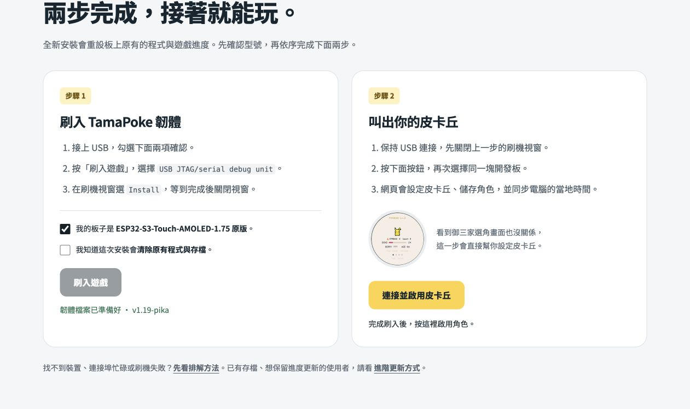
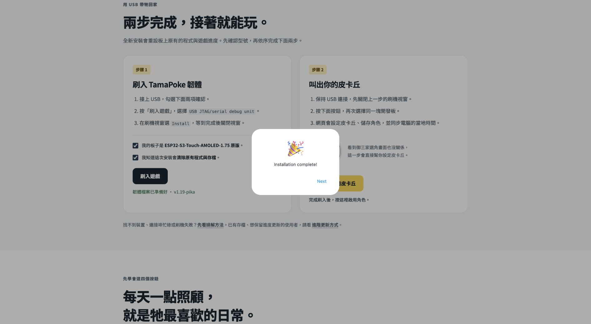
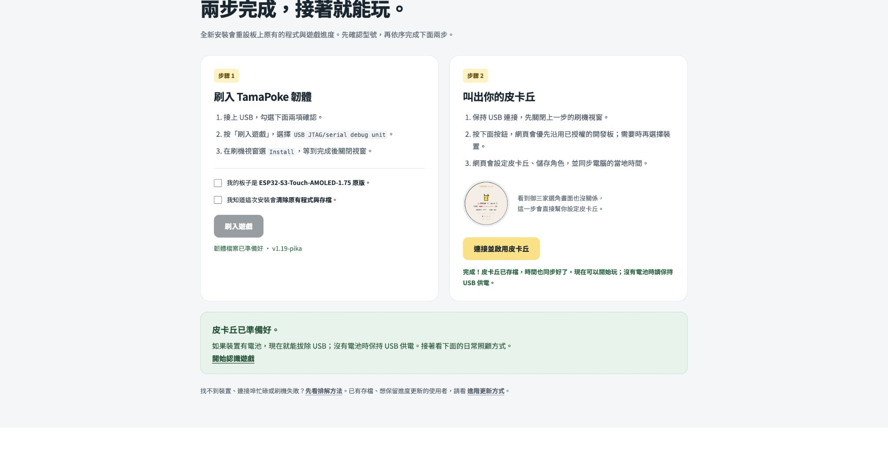
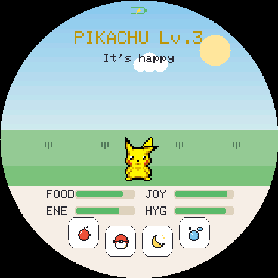

# 沒寫過程式，也可以開始玩

本教學使用 **微雪 Waveshare ESP32-S3-Touch-AMOLED-1.75 原版開發板**，對應韌體 **1.19-pika**。全程使用瀏覽器，不需要 Python、Arduino IDE 或自己編譯程式。

**[開啟網頁刷機與介面圖解](https://maxxtang.github.io/TamaPoke-Pikachu/)**

## 先準備

1. 完整型號相符的開發板：原版 **ESP32-S3-Touch-AMOLED-1.75**，16 MB Flash、8 MB OPI PSRAM。不是 1.75C，也不是任意 ESP32-S3 板。
2. 一條可以傳資料的 USB 線；只有充電功能的線不行。
3. 電腦與 Chrome 或 Edge。手機可看教學，請用電腦刷機。

沒有電池、喇叭或 microSD，也可以先透過 USB 供電玩皮卡丘。本版內建皮卡丘與雷丘的一般／異色動畫；151 隻角色的全部動畫沒有一起放進韌體。

## 第一步：從網頁刷入韌體

1. 用 USB 把開發板接上電腦，打開上面的網頁。
2. 點「開始網頁刷機」。
3. 核對完整型號，勾選板型確認。
4. 確認可以重設這塊板，再勾選「清除原有程式與存檔」。第一次安裝會把微雪原廠展示程式或其他舊韌體換掉。
5. 點「刷入遊戲」。瀏覽器會詢問要連接哪個裝置，通常顯示為 `USB JTAG/serial debug unit`；Windows 也可能顯示 COM 編號。
6. 選擇裝置並連接；在刷機視窗點 `Install`，依畫面完成安裝。
7. 等畫面顯示完成，**關閉刷機視窗**，保留 USB 連接，繼續第二步。

實際完成安裝時會看到：

刷入時不要拔 USB 或讓電腦睡眠。如果失敗，可重新接線後再試；不要改選其他不相容的晶片韌體。

## 第二步：啟用皮卡丘

1. 按「連接並啟用皮卡丘」。
2. 網頁會優先沿用剛刷機時已授權的開發板。若連過多塊板或尚未授權，才會跳出選擇視窗；這時選同一塊開發板。
3. 網頁會確認 TamaPoke 狀態、設定 #25 皮卡丘、立即存檔，並同步電腦當地時間。
4. 等網頁顯示「完成」，看開發板畫面。沒有電池時保持 USB 供電；有接妥電池才可以拔除 USB 繼續玩。

若你看到御三家選角或蛋，代表原版初始流程尚在進行，直接完成這一步即可。**網頁啟用不需要自己在選角畫面找到皮卡丘，也不需要輸入指令。**

## 第三步：學會第一次照顧

圖片由同版遊戲原始繪圖程式渲染，數值為教學示例，非實機照片。

- 輕點中間皮卡丘再放開：摸摸牠。
- 點最左邊食物：選樹果，皮卡丘喜歡藍色。
- 點精靈球：進入接球小遊戲，直接點球附近把球打回空中。
- 點燈泡：入睡；再點一次喚醒。畫面變黑或按 PWR 關螢幕不等於睡覺。
- 點最右邊洗澡：等約三秒，清潔恢復。

接著學三個滑動手勢：

| 操作 | 會看到什麼 |
| --- | --- |
| 主畫面向上滑 | 角色資料；左右滑可切四頁 |
| 主畫面向左或向右滑 | 圖鑑 |
| 主畫面向下滑 | 時間、音量、亮度、語言設定 |

**[看完整玩法與所有介面圖解](PLAYING.md)**。裝置介面目前有八種語言，預設英文，沒有中文；本網站用繁體中文解說每一頁。

## 遇到問題

| 情況 | 先做什麼 |
| --- | --- |
| 沒有可選的裝置 | 換資料線、直接接電腦，確認供電；必要時依微雪官方說明進入 BOOT 下載模式 |
| 連接埠忙碌 | 關閉刷機彈窗、其他序列埠網頁及 Arduino 監控，再重試 |
| 啟用時一直沒有回覆 | 確認先完成刷入，關閉刷機視窗，等開發板重開約三秒，再試第二步 |
| 螢幕變暗 | 先點一下喚醒，或短按 PWR；閒置時 AMOLED 會自動降亮度 |
| 拔 USB 就關機 | 板上沒有電池時，需要 USB 持續供電 |
| 時間不對 | 重新啟用可同步電腦當地時間，或主畫面向下滑自行調整 |
| 圖鑑沒有全部圖像 | 全部素材不是內建；沒有 microSD 時仍可玩本版皮卡丘／雷丘 |

## 驗證範圍

2026-11-23 已以 macOS Chrome、原版微雪 ESP32-S3-Touch-AMOLED-1.75、無 microSD 完成這兩步：公開網頁整包刷入、啟用 Lv.1 皮卡丘。另以唯讀方式核對板上韌體，硬體重開機後仍保存 #25 並重新載入內建動畫。詳細範圍與紀錄見 [USB 實機測試](HARDWARE_TEST.md)。Windows、Edge、電池斷電續玩與 microSD 完整素材未在這輪實測；遊戲介面圖仍是同版程式渲染示例。

[返回專案首頁](../README.md) · [微雪官方板卡文件](https://www.waveshare.com/wiki/ESP32-S3-Touch-AMOLED-1.75)
