# TamaPoke 新手玩法與介面圖解

這份教學適用於本倉庫的 **TamaPoke 1.19-pika**，硬體為 **Waveshare ESP32-S3-Touch-AMOLED-1.75**。拿到裝置後，主要用手指操作圓形觸控螢幕；日常餵食、遊戲和設定不需要電腦。

**本文圖片是同版實際繪圖程式產生的主機渲染示例，不是硬體實拍。** 圖中的角色、數值、時間與養成狀態只是示例；你的裝置會依自己的存檔顯示。頁面名稱以下用中文說明，裝置預設顯示英文，目前沒有中文介面。

[返回專案說明](../README.md)

## 第一次玩：先完成這五件事

1. 喚醒螢幕。若螢幕已變暗，先輕點一下，再開始操作；喚醒的第一個手勢不會同時按下遊戲按鈕。
2. 若看到 `Choose your starter`，點選 **BULBASAUR／妙蛙種子、CHARMANDER／小火龍、SQUIRTLE／傑尼龜** 其中一列。這是全新存檔的三種初始選擇，畫面本身沒有皮卡丘選項。若安裝流程已替你設定皮卡丘，會直接進入目前角色的主畫面。
3. 選好後輕點蛋三次，讓牠孵化；不點也會在約三個遊戲分鐘後孵化。初始選擇畫面還沒選好前，養成時間暫停。
4. 從主畫面向下滑，設定當地時間，按 `OK` 返回。
5. 給牠一顆樹果、玩一次接球，再按燈泡讓牠休息。之後依四條需求補充即可。

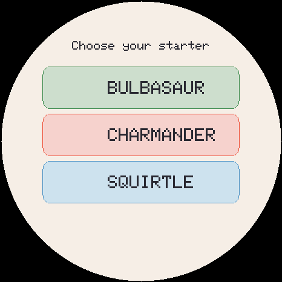

> 若角色區顯示 `No sprites / Load them onto the SD`，表示目前角色缺少可用圖像，不是重新觸摸蛋就能解決。本版內建皮卡丘 #25 與雷丘 #26 的一般／異色動畫；#1–9 另有簡單備用角色圖。其他角色的圖像和圖鑑縮圖需要相應的 microSD 圖像資料；圖鑑有 151 個登錄位置，不代表 151 種動畫都內建在韌體中。

## 先認識主畫面

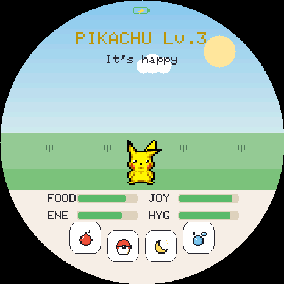

上方顯示電量、角色名稱、等級及狀態提示；中間是角色與場景；下方有四條需求和四個操作按鈕。背景會隨時間與角色變化，**夜景不代表角色已經睡著**。

四條需求都是 0–100，越高越好。條帶在 50 以上為綠色、25–49 為黃色、低於 25 為紅色。

| 畫面位置／英文 | 意思 | 怎麼照顧 |
| --- | --- | --- |
| 左上 `FOOD` | 飽足 | 餵樹果；糖果也能補少量飽足 |
| 右上 `JOY` | 心情 | 摸摸角色、餵喜歡的樹果、玩接球或訓練 |
| 左下 `ENE` | 精力 | 按燈泡，讓角色睡覺 |
| 右下 `HYG` | 清潔 | 按最右邊的洗澡按鈕 |

清醒時需求會逐分鐘下降；畫面出現便便時，清潔下降得更快。不要只看上方的一句提示，四條需求都要照顧。

底下按鈕**由左到右**是：**食物、精靈球小遊戲、燈泡、洗澡**。輕點中間角色是摸摸，可以增加心情與羈絆；手指輕點後就放開，持續按住角色超過三秒會開啟放生確認。

## 手勢與返回方式速查

滑動時用一個清楚、連續的動作，不要先按住很久才移動。

| 你想做什麼 | 從哪裡操作 | 返回方式 |
| --- | --- | --- |
| 看角色卡 | 主畫面向上滑 | 再向上滑，或輕點一般內容區 |
| 看四頁角色資料 | 角色卡內向左滑往後、向右滑往前 | 第一頁與第四頁到邊界就停止，不會循環 |
| 看圖鑑 | 主畫面向左或向右滑 | 點圖鑑頂部標題；或在第一頁向右滑 |
| 看圖鑑角色詳情 | 點圖鑑中的一格 | 點一下畫面，或向左／右滑，回格狀列表 |
| 設定時間、聲音、亮度、語言 | 主畫面向下滑 | `OK` 套用時間；上下滑動會取消這次時間編輯並離開 |
| 替角色命名 | 角色卡第一頁，點頂部姓名 | 鍵盤按 `OK`，回角色卡 |
| 力量訓練 | 角色卡第二頁，點 `TRAIN STRENGTH` | 十秒結束後自動返回；進行中點最頂端可提前離開 |
| 接球小遊戲 | 主畫面第二個精靈球按鈕 | 三次落地後結算並自動返回；進行中點最頂端可提前離開 |

角色卡有兩個例外：第一頁點頂部姓名會開鍵盤，第二頁點訓練按鈕會開始訓練；點其他一般內容區通常直接返回主畫面。鍵盤內沒有滑動取消功能，請用 `OK` 完成。

## 餵食：樹果是正餐，糖果偶爾吃

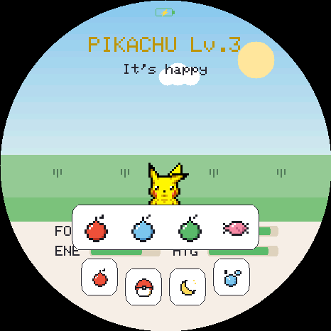

1. 角色清醒時，點最左邊的食物按鈕。
2. 中間出現四種食物，由左到右是**紅樹果、藍樹果、綠樹果、糖果**。
3. 點其中一種，就會餵食並關閉選單。選單約六秒後自動收起；點選單外也會收起。

普通樹果增加 25 飽足；牠最喜歡的樹果增加 35 飽足、10 心情，還會出現愛心，並在角色卡記住喜好。每種角色都有固定偏好的顏色，可以試三種找出答案；**皮卡丘喜歡藍樹果**。

糖果增加 10 飽足、12 心情，也增加 12 體重。體重高時精力下降得更快；接球、訓練和時間流逝能降低體重。所有需求最高到 100，吃很多不會突破上限。

## 小遊戲：讓精靈球別落地

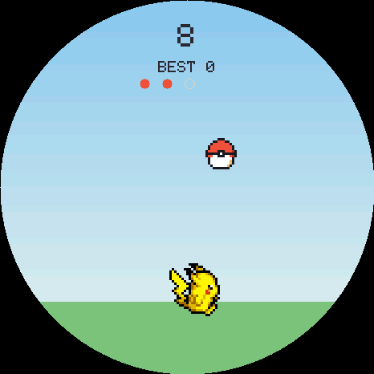

點主畫面第二個精靈球按鈕進入。**球落下時，直接點球附近把球打回空中**；每成功點中一次加一分，之後速度逐漸提高。上方三個小圓點代表剩餘機會；球第三次落地後，顯示分數與最高紀錄，約四秒後回主畫面。

正常結算會增加心情、羈絆與速度訓練值，消耗精力和少量飽足，並降低體重。速度訓練以每五分增加一點計算。**中途點最頂端離開不會取得本局獎勵**。角色睡覺、還是蛋或正進行告別儀式時，不能開始小遊戲。

## 睡眠：按燈泡才是真正休息

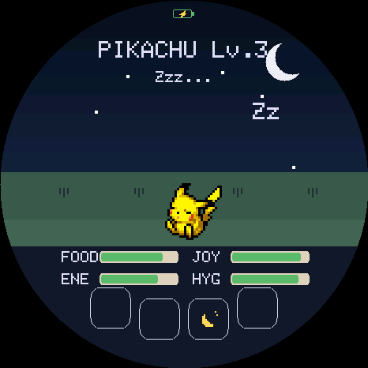

主畫面點第三個燈泡按鈕，角色就會入睡；再點一次就醒來。入睡後會出現 `Zz`，其他三個日常按鈕會停用。

睡眠每個遊戲分鐘恢復 6 精力，其他需求下降得慢很多，且不會因睡眠本身新增照顧失誤或逃跑累計。飽足、心情、清潔的睡眠下降下限分別是 30、35、45；若睡前已低於這些值，睡眠不會自動把它們補高。睡醒仍要餵食、洗澡和陪玩。

**關閉螢幕和讓角色睡覺是兩個不同操作。** 短按 PWR 只切換螢幕，角色仍會保持原本的清醒／睡眠狀態；想長時間休息，先按燈泡，再關螢幕。

## 洗澡：按一下，等泡泡結束

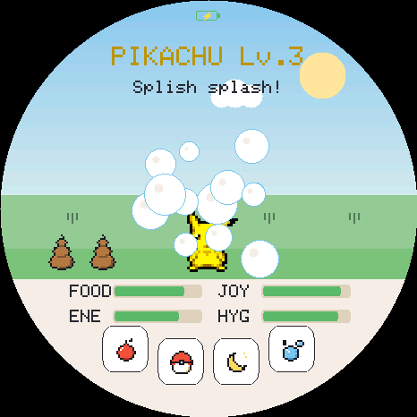

角色清醒時，點最右邊的洗澡按鈕。約三秒的泡泡動畫結束後，便便全部清除，清潔恢復到 100。**不需要逐顆戳破泡泡**，也沒有額外的洗澡操作頁；等動畫完成即可。

## 角色卡：四頁看懂自己的夥伴

主畫面向上滑開啟第一頁。每向左滑一次往下一頁，向右滑往前一頁；底部四個圓點表示所在頁。點一般內容區或向上滑即可回主畫面。

### 第一頁：個人資料

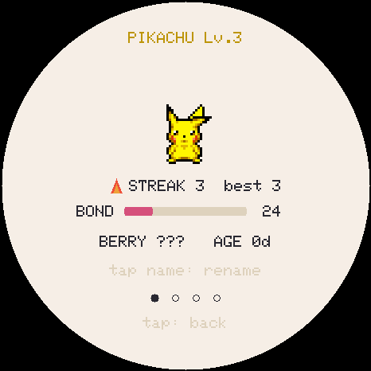

顯示姓名、等級、角色肖像、每日照顧連續天數 `STREAK`、最高連續天數 `best`、羈絆 `BOND`、最愛樹果與年齡。尚未吃到最愛樹果時顯示 `BERRY ???`；年齡以整天顯示，因此未滿一天會是 0 天。

每天第一次有效照顧可以累計連續天數，羈絆也會隨照顧成長；這些日期判定需要裝置時鐘有可用的時間。不是同一天一直點就一直增加天數。名字旁的 `*` 表示異色個體。

### 第二頁：能力與訓練入口

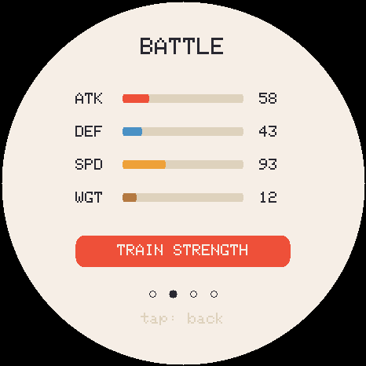

`BATTLE` 頁顯示攻擊 `ATK`、防禦 `DEF`、速度 `SPD`、體重 `WGT`。能力由物種、個體差異、等級及訓練構成。**這一頁是能力資料，現有遊戲沒有選對手進行戰鬥的操作。** 點底部 `TRAIN STRENGTH` 開始力量訓練。

### 第三頁：勳章

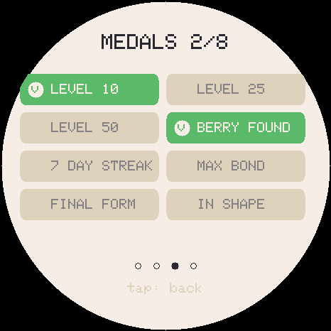

共有八種：等級 10、25、50；找到最愛樹果；連續照顧七天；羈絆達 100；到達最終型態；以及等級至少 5、體重為 0 且沒有照顧失誤的健康勳章。彩色代表這隻個體已取得，灰色代表尚未取得。

七天是其中一枚**勳章**的條件，與後面說明的三天告別門檻不同。

### 第四頁：成長進度

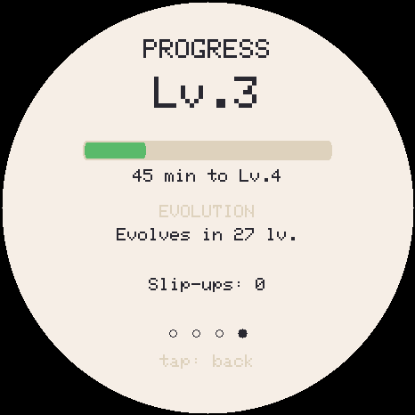

顯示目前等級、距離下一級的分鐘數、進化狀態與照顧失誤 `Slip-ups`。預設每 60 個遊戲分鐘升一級，睡眠中仍會成長。

清醒時只要某項需求低到 10 以下，便可能記一次照顧失誤；同類累計有約一小時冷卻。**每一次失誤會把進化需求延後一級**。進化時四項需求還必須都至少 40，所以等級到了仍不能進化時，先補滿需求並確認角色已醒來。

## 力量訓練：十秒快速點擊

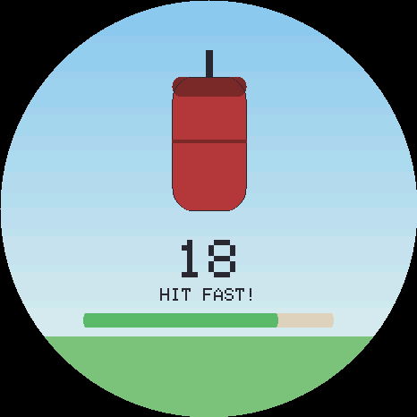

從角色卡第二頁點 `TRAIN STRENGTH`，開始十秒倒數。手指**反覆點下、放開沙包附近**，不要一直按著不放；下方數字是有效點擊次數，時間條會縮短。

時間到後顯示命中數、實際增加的力量與最高紀錄，約三秒半後回主畫面。每四次命中增加一點攻擊訓練值，每局最多增加 18 點，訓練總值最高 100；已接近上限時，結算只顯示真正加進去的量。

訓練會消耗精力與飽足，也提升心情、羈絆並降低體重。原版 **1.75** 在進行中**點畫面最頂端就能離開，提前離開不結算獎勵**。這份教學的板型沒有 1.75C 專用的「長按退出」按鈕。

防禦的訓練則來自長期照顧：清醒時持續維持四需求都至少 40，累積十二小時可增加一點防禦訓練值。睡眠會暫停這段累計。

## 命名鍵盤：最多十一個字元

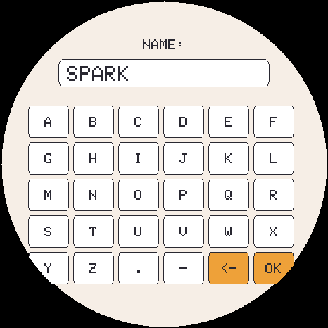

在角色卡第一頁點最頂端姓名，開啟鍵盤。可輸入 **A–Z、英文句點 `.` 和連字號 `-`**，最多十一個字元；不提供中文、空格或小寫輸入。`<-` 刪除最後一個字元，`OK` 儲存並回角色卡。

把名字刪空後按 `OK`，就恢復顯示物種名稱。鍵盤不提供取消鍵或滑動退出；若只想保留原名，沒有改動時直接按 `OK`。

## 圖鑑：收藏自己養過的角色

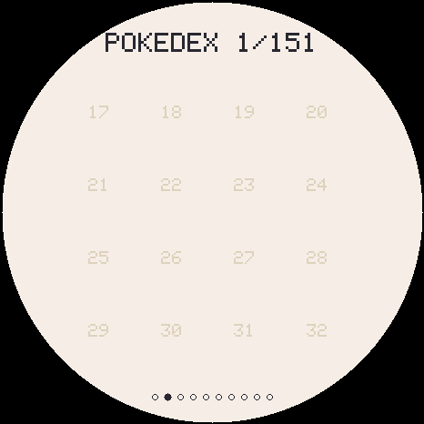

主畫面左右任一方向滑動都會開啟圖鑑，從第一頁開始。共十頁，每頁最多十六格，涵蓋 #001–#151：**向左滑翻下一頁，向右滑翻上一頁**。點頂部 `POKEDEX` 標題可直接回主畫面；第一頁再向右滑也會離開。

孵化或進化得到的物種會登錄：已登錄顯示彩色圖，未登錄顯示剪影，養過異色版本會標上 `*`。如果缺少縮圖資料，格子可能只顯示編號；這不等於存檔被清空。

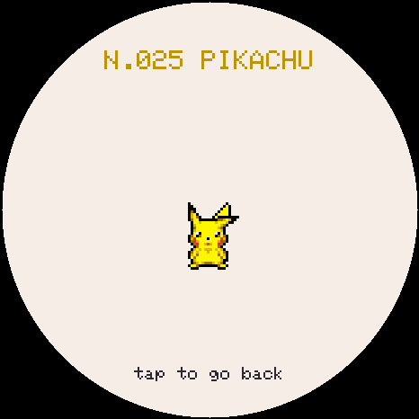

點一格看大圖詳情。未登錄物種名稱顯示 `???`，圖像也是剪影；已登錄的角色會在有動畫資料時播放動畫。**點畫面任意處，或水平滑動一次，都先回格狀列表**，不是直接切到下一隻。圖鑑的縮圖與大圖能否顯示，仍取決於裝置上是否有相應圖像。

## 設定：時間、音量、亮度與八種語言

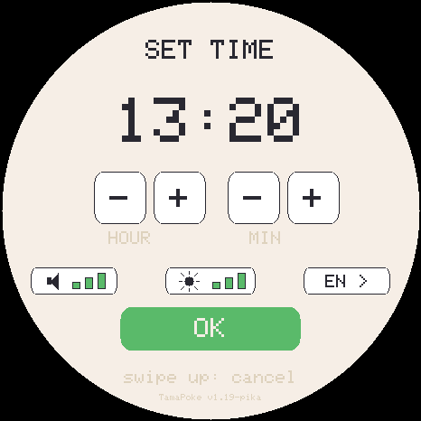

從主畫面向下滑開啟 `SET TIME`：

- 左邊一組 `− / +` 調小／調大「時」，右邊一組調整「分」，使用 24 小時制。
- 左下喇叭按鈕依序切換**大聲 → 中聲 → 小聲 → 靜音 → 大聲**。
- 中間太陽按鈕切換**高 → 中 → 低**三段亮度。
- 右下語言代碼依序切換 **ES 西班牙文、EN 英文、FR 法文、DE 德文、IT 義大利文、PT 葡萄牙文、JA 日文、KO 韓文**，再回到 ES。**目前沒有中文**，新存檔預設 EN。
- 點 `OK` 套用時間並返回主畫面；向上或向下滑動則離開，不套用這次改動的時與分。

音量、亮度與語言在點選時就會儲存，所以滑動離開**不會撤銷**這三種設定。時間頁只調整時、分，保留原日期，沒有日期或時區選單。

## 進化：達標後由你決定

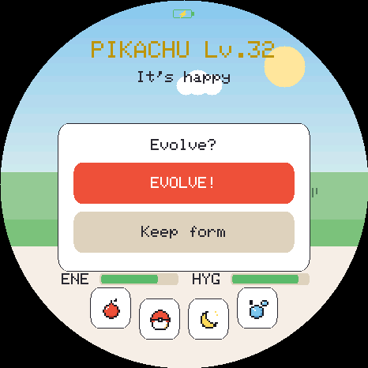

有下一階段的角色達到指定等級、四需求都至少 40，而且清醒時，主畫面會出現 `EVOLVE!`。**點這個按鈕才會開啟選擇**；只摸摸角色不會直接讓牠進化。

選上方的進化選項會開始約五秒的變身動畫；選下方 `Keep form` 會保留目前外型，到下一次升級再提示。對話約十二秒後自動收起，點兩個選項外也會收起。以皮卡丘為例，沒有照顧失誤時需要 Lv.30，進化成雷丘；每次失誤會再多要求一級。

伊布的分支由遊戲抽選，會優先挑尚未在圖鑑登錄的分支；現有觸控介面沒有選進化石或手動挑分支的功能。

## 告別、放生與逃跑：都會開始下一輪養成

這三種情況會播放約十秒儀式，期間無法操作日常按鈕，之後出現新蛋。原個體的姓名、能力訓練、羈絆與個體勳章會在下一隻孵化時重設；圖鑑、異色登錄、每日照顧連續紀錄及遊戲／訓練最高分等玩家收藏紀錄會保留。這些操作沒有儀式中的撤銷按鈕，想繼續養目前這隻就選擇保留或取消。

### 告別：完成一段旅程

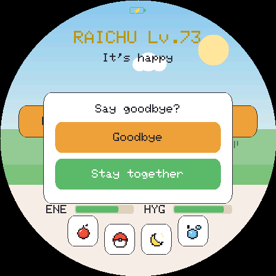

角色已是**最終型態、年齡達三個遊戲日（4,320 分鐘）、而且清醒**時，主畫面會出現想對你說話的提示。點它開啟選擇：上方 `Goodbye` 進入告別，下方 `Stay together` 繼續一起生活，約一天後再提示。

**不會到時間就自行消失。** 完成告別會讓下一顆蛋的稀有／異色抽選條件更有利，仍屬隨機，不保證抽到指定角色。

### 放生：主動結束目前養成

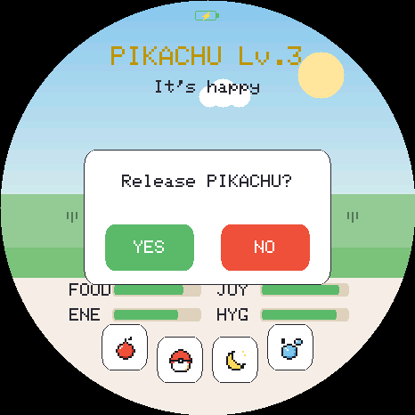

在主畫面按住角色區**超過三秒、不要移動**，出現 `Release ...?` 確認框後放開手指。選 `YES` 才會放生；選 `NO`、點其他位置，或等待約十秒，會取消確認。放生沒有完成告別的抽選加成。

### 逃跑：嚴重忽略後的提示

清醒時四需求**全部為 0 且持續累計約六十分鐘**，才會出現被忽略的提示。**現有版本要點這個提示才開始逃跑儀式，不會在背景自動把角色移除。** 這個入口沒有像告別那樣的第二層確認，請先照顧牠。

補回至少一項需求後，下一個清醒的分鐘更新會清掉這段忽略累計；睡眠會暫停這段累計。逃跑後的下一顆蛋不享有稀有蛋加成。

## PWR、關螢幕與保存進度

本教學的 **ESP32-S3-Touch-AMOLED-1.75**：

- **PWR 短按**：切換螢幕關閉／開啟。螢幕關閉後，輕點螢幕也能喚醒；第一次觸摸只喚醒，不執行遊戲操作。
- **PWR 持續按約四秒**：電源管理晶片關機。這是硬體斷電操作，不是返回主畫面或睡覺。
- 久未操作時約九十秒會自動變暗，約五分鐘會更暗；這也不等於角色已入睡。

不要套用 **1.75C** 的三連按鎖屏或 BOOT 靜音說明；本版 **1.75** 沒有那些遊戲快捷鍵。正常遊玩不需要按 BOOT。

餵食、睡眠切換、洗澡完成、遊戲／訓練結算、命名和進化等會自動存到板內。時間自然流逝的進度約每五分鐘標記一次，等螢幕變暗、關閉或角色睡眠時再寫入；摸摸也不保證每次立即寫入。**不要在剛操作完的一瞬間拔電或長按關機**；先完成一個照顧動作，讓裝置有時間保存。更新／重刷前先備份；清除整片 Flash 的全新安裝會連遊戲存檔與設定一起清除。

時鐘有效時，重新開機會計算離線經過的時間，最多補算十四天；離線清醒需求最多降到 15，不新增照顧失誤或逃跑累計，進化也會等你回來點選。若時鐘失去供電而遺失時間，不能保證正確補算離線多久。想隔天再玩，先讓角色睡覺、讓保存完成，再收起裝置。

## 每天的簡單照顧順序

**喚醒螢幕 → 看四條需求 → 餵樹果 → 洗澡 → 玩接球或訓練 → 精力低時按燈泡休息。** 有空再向上滑看成長、勳章和最愛樹果，左右滑收集圖鑑。養成不需要一直連續點螢幕；讓需求保持健康，比只追求等級或分數更容易順利進化。
